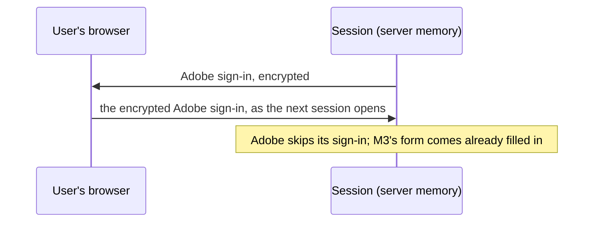
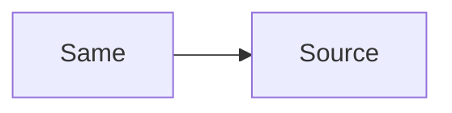
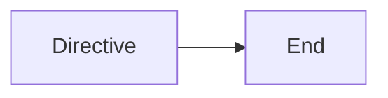
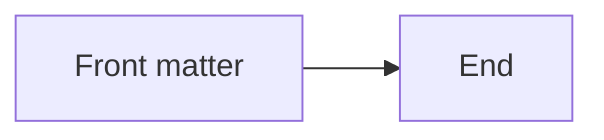
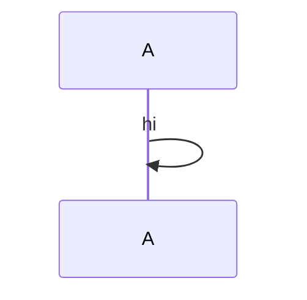
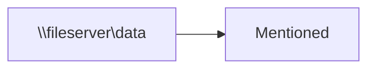

# Diagrams

## Sequence

Each sign-in is kept in the user's own browser.



## Twice




## Broken

The `;` ends the note, and what follows is not a statement.

```mermaid
sequenceDiagram
  participant S as Session
  Note over S: Adobe skips its sign-in; M3's form comes already filled in
```

## Hostile





- A diagram in a list item:

  ```mermaid
  flowchart LR
    E[In a list] --> F[Item]
  ```

```js
const notADiagram = true;
```

## Far images

Images on another computer, which Mermaid would load while drawing.

```mermaid
flowchart LR
  A@{ img: "file://evilhost/share/x.png", label: "Far", pos: "t", w: 60, h: 60 }
```

```mermaid
flowchart LR
  A@{ img: "file:\x2f\x2fevilhost/share/x.png", label: "Escaped", pos: "t", w: 60, h: 60 }
```



```mermaid
flowchart LR
  A@{ img: "//evilhost/share/x.png", label: "Scheme-relative", pos: "t", w: 60, h: 60 }
```

A share named in a label is only text, and the diagram is drawn.


