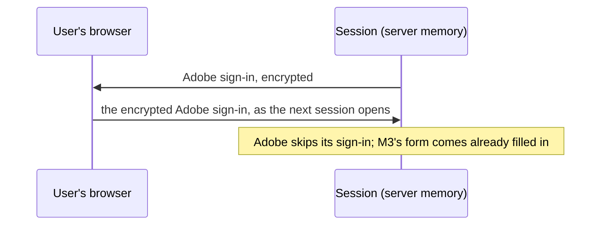
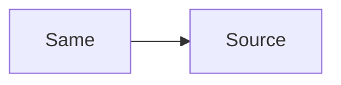
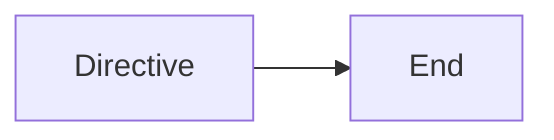
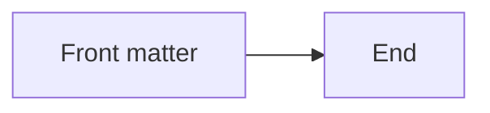

# Diagrams

## Sequence

Each sign-in is kept in the user's own browser.



## Twice




## Broken

The `;` ends the note, and what follows is not a statement.

```mermaid
sequenceDiagram
  participant S as Session
  Note over S: Adobe skips its sign-in; M3's form comes already filled in
```

## Hostile





- A diagram in a list item:

  ```mermaid
  flowchart LR
    E[In a list] --> F[Item]
  ```

```js
const notADiagram = true;
```
