# Fonts cheatsheet

> Personal cheatsheet for choosing a typeface: the picks in daily use, the alternatives worth
> knowing, when each one fits, and a preview of each.
>
> Links checked and previews rendered on 2026-11-12. Read a font's licence before you ship
> it to other people; the licence section says which notes here were checked.

## Contents

- **[Pick by job: Inter for screens, SF Mono or Geist Mono for code, XCharter for long reads](#pick-by-job-inter-for-screens-sf-mono-or-geist-mono-for-code-xcharter-for-long-reads)**
- **[Read a preview: same words, same size, so only the typeface differs](#read-a-preview-same-words-same-size-so-only-the-typeface-differs)**
- **[Sans-serifs for interfaces and screen text](#sans-serifs-for-interfaces-and-screen-text)**
    - [Inter](#inter)
    - [SF Pro](#sf-pro)
    - [Public Sans](#public-sans)
    - [Ubuntu](#ubuntu)
    - [Helvetica Neue](#helvetica-neue)
    - [Circular](#circular)
    - [FF Kievit Pro](#ff-kievit-pro)
- **[Serifs for long-form reading](#serifs-for-long-form-reading)**
    - [XCharter](#xcharter)
    - [Bookerly](#bookerly)
    - [Selane Web ST One](#selane-web-st-one)
- **[Monospace for code and terminals](#monospace-for-code-and-terminals)**
    - [SF Mono](#sf-mono)
    - [Geist Mono](#geist-mono)
    - [DM Mono](#dm-mono)
    - [Consolas](#consolas)
    - [Monaco](#monaco)
- **[Free to embed, or tied to a vendor: check before you publish](#free-to-embed-or-tied-to-a-vendor-check-before-you-publish)**
- **[Install a font, or add one to this page](#install-a-font-or-add-one-to-this-page)**

## Pick by job: Inter for screens, SF Mono or Geist Mono for code, XCharter for long reads

| Job | Use | Why this one |
| --- | --- | --- |
| Interface, dashboard, docs on a screen | [Inter](#inter) | Free, and already the text font across this repo's tools |
| Code in an editor or terminal on your own machine | [SF Mono](#sf-mono) | Already set in Ghostty and Sublime Text |
| Code inside something you publish | [Geist Mono](#geist-mono) | Free to embed; SF Mono is not |
| Paper, essay, anything read for more than a page | [XCharter](#xcharter) | Free serif with a matching math font |
| Headings that should not look like body text | [Circular](#circular) | Rounder and friendlier than Inter, but commercial |
| Small labels and field names | [DM Mono](#dm-mono) | Reads as a label, not as code |

If two fonts both fit, take the free one: it can go into a web page, a PDF or a repo without
a second thought.

## Read a preview: same words, same size, so only the typeface differs

Every text preview sets the same large line (44px regular, where the letter shapes that
identify a font are easiest to see), heading (26px bold), paragraph (16px, with one italic
and one bold phrase) and small grey line (13px). Every monospace preview sets the same code at
14px in the regular weight. The images are 720px wide, drawn at 2x.

The previews were drawn by Chrome on Linux. macOS draws the same font a little heavier, so
a font you know from a Mac looks slightly thinner here. The letter shapes are the same.

Look at these four things:

- **`Q`, `G`, `R`, `a` and `g` in the large line.** These differ most between typefaces,
  and a bold weight can hide them: the tail on Helvetica Neue's `a` nearly vanishes in bold.
- **The paragraph at reading distance.** Does it look even, or do some letters catch the eye?
- **`Il1 O0 rn m` in the small line.** Capital I, lowercase l and the digit 1 should differ,
  and so should O and 0.
- **The figures `0123456789`.** Lining figures stand as tall as capitals; oldstyle figures
  dip below the line and suit running text, not tables.

## Sans-serifs for interfaces and screen text

### Inter

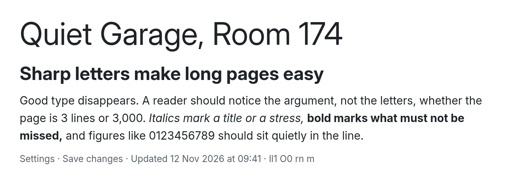

- **Use it for:** interfaces, tables and documentation on a screen. It is the text font of
  `local-viewer` and `single-file`, and the sans-serif that `fedora.md` substitutes for
  Segoe UI, Helvetica Neue and others.
- **Skip it when:** capital I and lowercase l must be told apart (they are the same bar, as
  the preview shows), or when the page should have a look of its own. Inter is a common
  default.
- **Get it:** <https://rsms.me/inter/> (4.1). SIL Open Font License.

### SF Pro

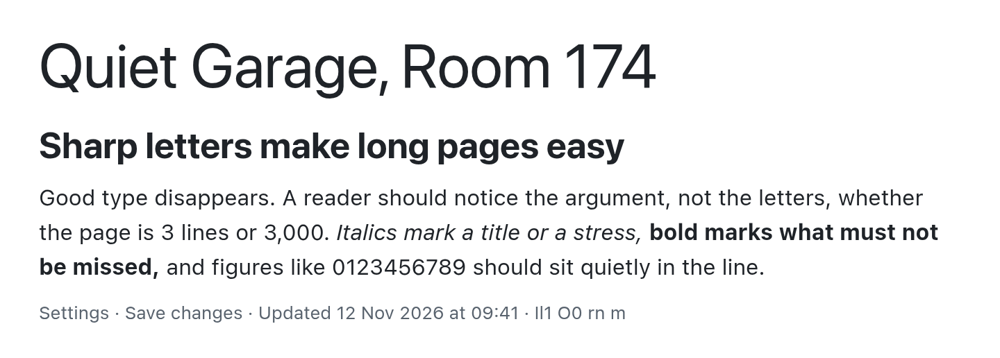

- **Use it for:** mock-ups of Apple interfaces, and pages that only you read on a Mac.
  `local-viewer` shows it on macOS, where it is the system font.
- **Skip it when:** the font has to be bundled or embedded. Apple's licence allows
  mock-ups only, which is why `local-viewer` bundles Inter for every other system.
- **Get it:** <https://developer.apple.com/fonts/> (a `.dmg`). The preview is the variable
  `SF-Pro.ttf` (version 16, 2020), so the heading uses the tighter display cut as it
  would on a Mac. A Mac also adjusts letter spacing by size, which this preview
  does not.

### Public Sans

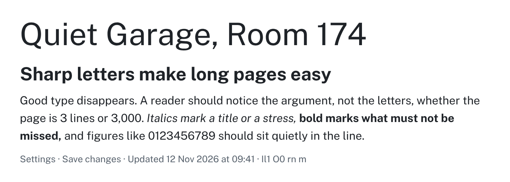

- **Use it for:** plain, neutral pages such as forms and reference material. It comes from
  the U.S. Web Design System.
- **Skip it when:** you already use Inter. The two are close enough that mixing them looks
  like a mistake.
- **Get it:** <https://github.com/uswds/public-sans> (2.001). SIL Open Font License.

### Ubuntu

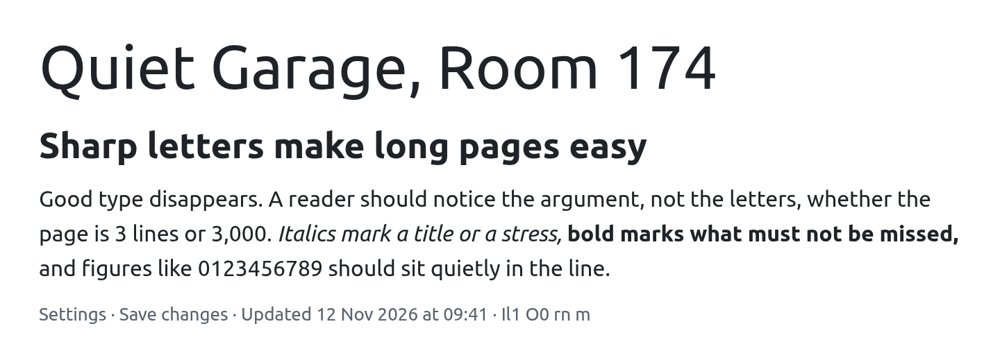

- **Use it for:** a warmer, more informal page. The curved l and the open shapes give it
  more character than Inter.
- **Skip it when:** the page should not remind people of Ubuntu. It is that system's brand
  font and is recognised as such.
- **Get it:** <https://fonts.google.com/specimen/Ubuntu> for this classic family (the
  preview was drawn from it). <https://design.ubuntu.com/font> is Canonical's own page.
  Ubuntu Font Licence.

### Helvetica Neue

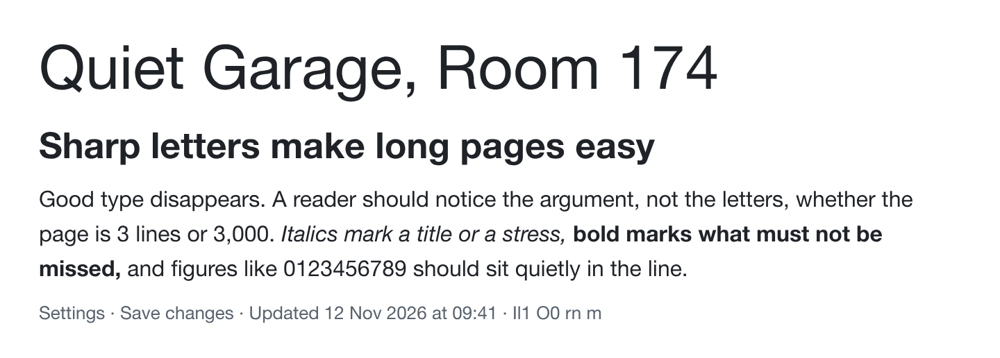

- **Use it for:** mock-ups that must match a design already set in it. It ships with macOS.
- **Skip it when:** the result leaves your machine. It is a commercial font, and the GitHub
  copy below is an unofficial mirror. Inter covers the same ground for free.
- **Get it:** already on macOS. Mirror: <https://github.com/ifvictr/helvetica-neue>.

### Circular

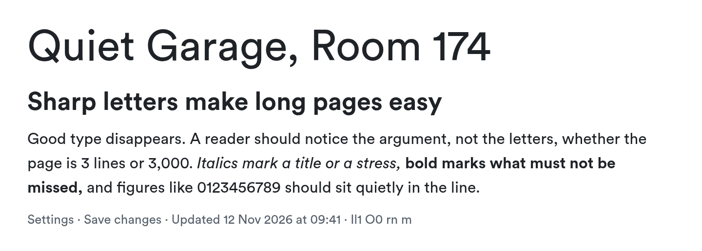

- **Use it for:** headings and titles. The round letters are friendly at large sizes. It
  was first noted here as Airbnb's brand font.
- **Skip it when:** you cannot buy a licence for the project. It is commercial.
- **Get it:** <https://lineto.com/typefaces/circular> (commercial).

### FF Kievit Pro

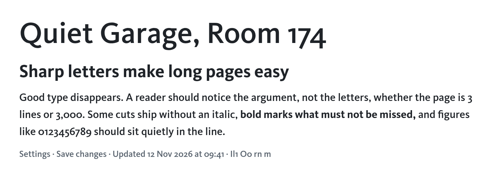

The preview sets the Medium weight, the one picked here, so the paragraph is darker than
the others on this page. It is drawn without an italic.

- **Use it for:** short, confident text such as headings, cards and labels. The narrow
  letters fit more words on a line than Inter.
- **Skip it when:** numbers sit in tables or next to capitals. Its default figures are
  oldstyle (see `3,000` and `09:41` in the preview). It is also commercial.
- **Get it:** <https://www.myfonts.com/collections/ff-kievit-font-fontfont> (commercial).
  CSS name: `'FF Kievit Pro'`.

## Serifs for long-form reading

### XCharter

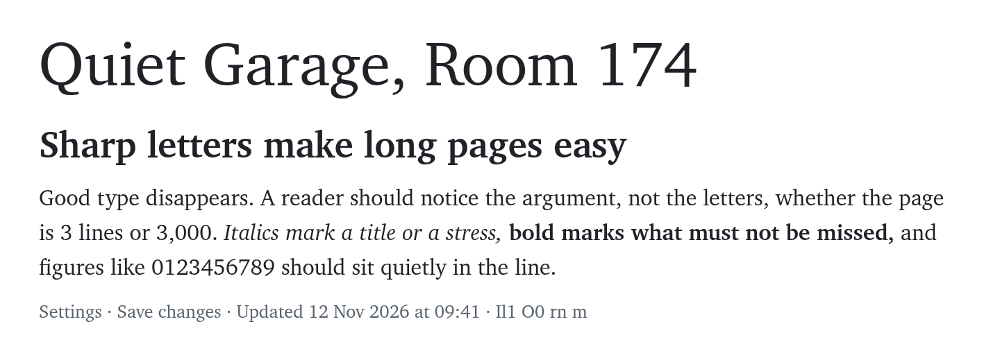

- **Use it for:** papers, essays and PDFs. It is Michael Sharpe's extension of Bitstream
  Charter, with small caps and oldstyle figures in all four styles and a matching math
  font, so text and formulas agree. First noticed as the body font of the paper "Formal
  Verification of Signal".
- **Skip it when:** the text is an interface. Sturdy serifs at 13px in buttons and menus
  look heavy next to a sans-serif.
- **Get it:** <https://ctan.org/pkg/xcharter> (1.26, OpenType files in `opentype/`). On
  Fedora, `sudo dnf install texlive-xcharter texlive-xcharter-math texlive-newtx` for
  LaTeX and desktop apps: the package links its fonts into `/usr/share/fonts/xcharter`,
  so browsers and other apps can use XCharter by name. Fedora 42 packages version 1.24.
- **Licence (read from its README):** Bitstream's free Charter licence, which allows use,
  modification, sale and redistribution if the notice stays intact. The LaTeX support files
  are LPPL 1.3.

In LaTeX, from the package documentation (not compiled here):

```latex
% pdfLaTeX: the documentation's examples pair it with newtxmath
\usepackage{XCharter}
\usepackage[charter]{newtxmath}

% XeLaTeX or LuaLaTeX: loads fontspec, unicode-math and XCharter-Math.otf
\usepackage[otfmath]{XCharter}
```

The documentation also names an `xcharter` option for `newtxmath`.

### Bookerly

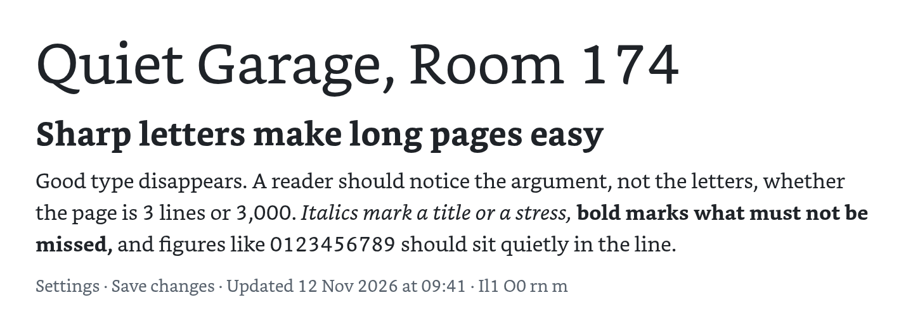

- **Use it for:** reading books on a Kindle or on your own screen. It is Amazon's Kindle
  font, and `kindle.txt` has the steps to load custom fonts on the device.
- **Skip it when:** you publish the result. It belongs to Amazon. Its figures are oldstyle
  (see `3,000` in the preview), which is also wrong for tables.
- **Get it:** it ships with Kindle devices and apps.

### Selane Web ST One

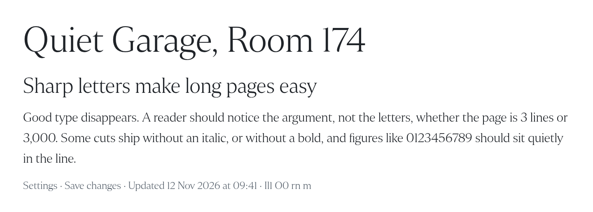

The font has one weight, with no bold or italic, so the preview shows the regular cut
throughout.

- **Use it for:** large headlines with a newspaper feel. It was seen on The Straits Times.
- **Skip it when:** the text is small or long. The strokes are thin and the contrast is
  high, so the 13px line in the preview is already faint. It is not a free font.
- **Get it:** no public source found.

## Monospace for code and terminals

All five have a slashed or dotted zero and a distinct `I`, `l` and `1`. Choose on texture
and on licence.

### SF Mono

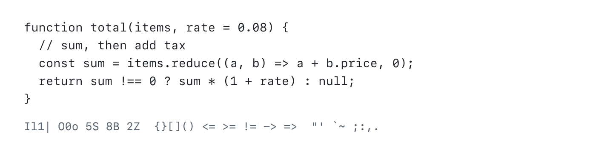

- **Use it for:** your own editor and terminal. It is set in `ghostty.md` and `sublime.md`,
  and `fedora.md` substitutes it for Consolas, Source Code Pro and other monospace names.
- **Skip it when:** the font has to travel with the output, such as a web page or an
  exported file. It is Apple's, and is not licensed for embedding.
- **Get it:** install steps for macOS and Linux are in `ghostty.md`.

### Geist Mono

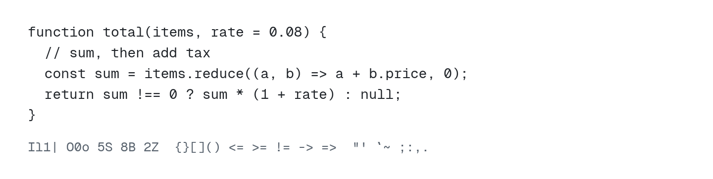

- **Use it for:** code in anything you publish. `local-viewer` bundles it for code blocks,
  notebook output and the JSON tree.
- **Skip it when:** the code sits next to SF Mono elsewhere on the same screen. Geist Mono
  is squarer and a little narrower, and the mismatch shows.
- **Get it:** <https://vercel.com/font>, source at <https://github.com/vercel/geist-font>.
  SIL Open Font License.

### DM Mono

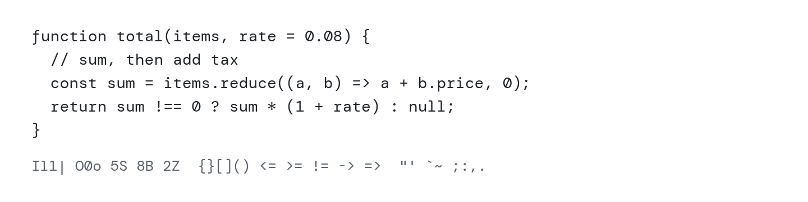

- **Use it for:** short labels, field names and captions. `local-viewer` sets JSON field
  names in it.
- **Skip it when:** the text is dense code. The f that drops below the line and the
  slanted zero are charming in a label and tiring over fifty lines.
- **Get it:** <https://fonts.google.com/specimen/DM+Mono>. SIL Open Font License.

### Consolas

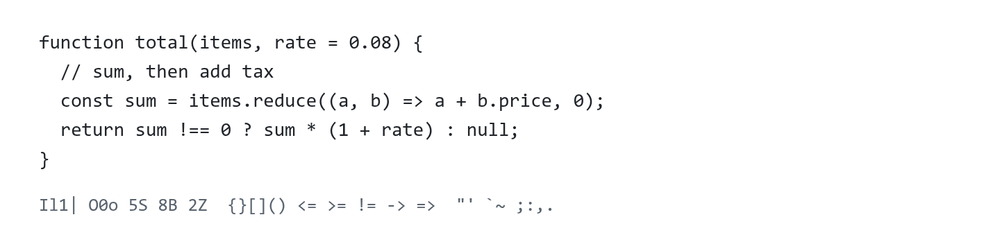

- **Use it for:** matching what Windows users see. It ships with Windows and Office, and
  it is the narrowest of the five, so more code fits on a line.
- **Skip it when:** you are not on Windows and have no reason to match it. It is
  Microsoft's, and `fedora.md` already swaps it for SF Mono.
- **Get it:** already on Windows.

### Monaco

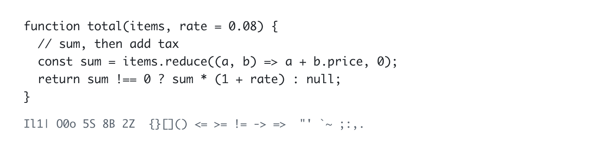

- **Use it for:** the classic macOS terminal look.
- **Skip it when:** you need bold or italic. The copy here has a regular weight only, so
  syntax themes that rely on bold lose their emphasis. It is Apple's.
- **Get it:** already on macOS.

## Free to embed, or tied to a vendor: check before you publish

**A vendor's font is fine on your own screen and a problem once it ships inside a page, a
PDF or a repo.** That is the main reason to skip a font you otherwise like.

| Free to embed and redistribute | Owned by a vendor |
| --- | --- |
| Inter, Public Sans, Geist Mono, DM Mono (SIL Open Font License) | SF Pro, SF Mono, Monaco (Apple) |
| Ubuntu (Ubuntu Font Licence) | Consolas (Microsoft) |
| XCharter (Bitstream Charter licence) | Helvetica Neue, FF Kievit (Monotype) |
| | Circular (Lineto), Bookerly (Amazon), Selane (The Straits Times) |

The free column was checked against each font's licence file on 2026-11-12. The vendor
column is from memory, except SF Pro, which follows the note in the `local-viewer` README.

## Install a font, or add one to this page

Install for your user only, with no root:

```bash
mkdir -p ~/.local/share/fonts
cp ~/path/to/*.otf ~/.local/share/fonts/
fc-cache -f ~/.local/share/fonts
```

`fedora.md` has the fontconfig file that maps other font names to the ones you installed.

To add a font to this page, put its files in a folder outside the repo, add one line to
the `FONTS` list in `fonts/render.mjs`, and render it:

```bash
node fonts/render.mjs ~/path/to/font-files new-font-slug
```

The script writes `fonts/new-font-slug.png` and fails if the font did not load, so a
fallback font never passes as a preview. Commit the image, not the font files.
